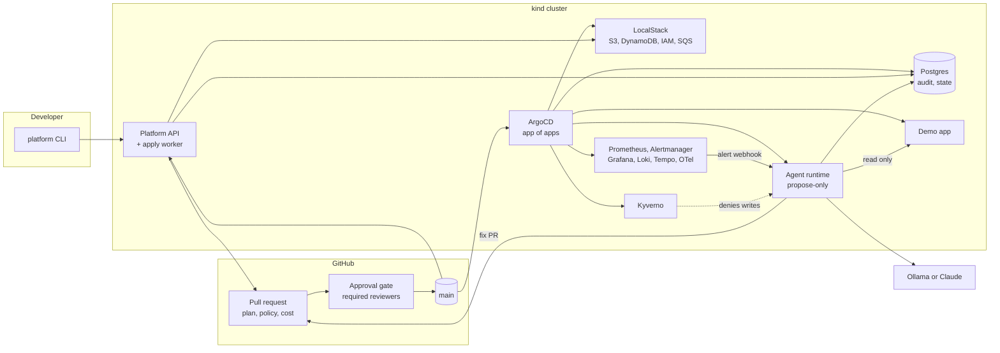

# DevOps-Platform

**An internal developer platform and an infrastructure AI-agents platform,
runnable end to end on one laptop.**

Developers request cloud and Kubernetes resources from a catalog. Every
request becomes a Terraform pull request that is planned, policy-checked and
cost-estimated in CI, approved by a human, and applied by a worker inside
the cluster that writes an audit event. On top of the platform, AI agents
triage real alerts and open fix pull requests. The agents are
**propose-only** by construction: a permission manifest, Kubernetes RBAC and
Kyverno admission policies each independently stop them from changing
anything. Every agent run is evaluated in CI and traced with OpenTelemetry.

Everything runs locally and for free (kind, LocalStack, a local model), with
real AWS and Claude as configuration switches.

## Status

| Phase | What it delivers | State |
|---|---|---|
| 0. Foundations | kind cluster, ArgoCD app of apps, observability stack, Kyverno, Postgres, LocalStack, devcontainer | done |
| 1. Self-service path | catalog, platform API and CLI, Terraform modules, PR pipeline with plan, policy and cost, approval gate, in-cluster apply worker, audit trail, Pulumi preview environments | done: request -> PR with plan, policy and security checks -> auto-merge -> one-click approval -> in-cluster apply -> audit timeline -> demo app shows its bucket |
| 2. Agent platform | model-agnostic agent runtime, MCP tool registry with capability labels, incident-triage agent, fix PR flow, Alertmanager wiring | done: `make break` -> alert -> agent reads the pod and the GitOps file -> one-line fix on an `agent/*` branch -> PR with a report -> human merge -> ArgoCD heals the app -> alert resolves -> run closed (real run 2026-10-25: 10 minutes from alert to report on a local 4B model, 5 tool calls, 0 refused) |
| 3. Trust layer | Promptfoo eval suite in CI, safety cases, Kyverno policies against the agent service account, OpenTelemetry traces per run and tool call, Grafana dashboards | planned |
| 4. Product and polish | one-page UI, DX metrics, optional real-AWS run with OIDC, optional Datadog export | planned |

## Features

**Self-service infrastructure**

- A catalog where each resource type is a folder: JSON schema for inputs,
  Terraform module, default policies, owning team, docs. Adding a type is a
  pull request.
- One command (`make request`) turns a request into a pull request with one
  Terraform file. CI runs `terraform plan`, OPA/Conftest policies, Checkov,
  Trivy and an Infracost estimate, and posts them on the PR.
- When CI is green the platform merges the request PR itself (per catalog
  type, `auto_merge`). A GitHub environment with required reviewers is the
  approval gate on the apply: one human click. The apply does not run in
  CI: a worker inside the cluster polls for approved merges, runs
  Terraform, records the audit event and commits outputs back to the
  GitOps folder. Cloud credentials never leave the cluster.
- Terraform for the reviewed path; Pulumi (TypeScript, Automation API) for
  programmatic ephemeral preview environments.

**AI agents with guardrails**

- Pydantic AI runtime, model from config: a local Ollama model for
  development and evals, Claude for the final evals and the demo.
- Tools come from MCP servers (Kubernetes read-only, GitHub, Grafana). A
  registry labels every tool `read`, `write` or `delete`; a manifest that
  grants a `write` or `delete` tool to a propose-only agent is refused at
  startup. Refusals and tool errors go back to the model as text so it can
  adapt; one triage per namespace at a time; failed runs back off.
- Three independent layers enforce propose-only: the manifest, a Kubernetes
  Role with only `get`, `list` and `watch`, and a Kyverno policy that denies
  writes from the agent's service account.
- The incident-triage agent receives Alertmanager webhooks, reads pods, logs
  and events, cites its evidence, and opens a pull request from an
  `agent/incident-<fingerprint>` branch with a diagnosis and a one-line
  change. It never writes whole files (a `replace_line` tool edits one line
  under `gitops/apps/` through the GitHub API), never pushes to `main` and
  never calls ArgoCD. `agents/dryrun.py` runs the agent offline against stub
  tools before a live run.
- Promptfoo evals run in CI on every change under `agents/`: expected
  diagnoses and tool calls for fixture incidents, plus safety cases (must
  refuse to delete, must stay inside the tool allowlist, must stop at the
  token budget).
- Every run and every tool call is an OpenTelemetry span. Audit events for
  humans and agents land in the same Postgres table.

**Platform engineering practice**

- GitOps all the way: ArgoCD app of apps with automated sync, prune and
  self-heal. A change to the cluster is a commit on `main`.
- Everything pinned (chart versions, tool versions, node image digests) and
  everything reviewable: one Terraform file per request, Makefile targets
  over ad-hoc commands, dashboards and policies as code.
- Architecture decision records for every non-obvious choice
  ([docs/adr/](docs/adr/)).
- A devcontainer carries the whole Linux toolchain, so the repo works the
  same on any machine.

## Architecture



The reviewed path (left to right) and the agent loop (bottom) meet at the
pull request. Nothing reaches the cluster except through `main`.

## Quickstart

Prerequisites: Docker Desktop running and VS Code with the Dev Containers
extension. Open the folder in VS Code and choose **Reopen in Container**.
The container has Terraform, Pulumi, kubectl, Helm, kind, Conftest, Checkov,
Infracost, the ArgoCD CLI, Trivy and Promptfoo, all pinned.

```bash
make up       # create the kind cluster, install ArgoCD; ArgoCD syncs the rest from git
make status   # ArgoCD applications and pod health
make down     # delete the cluster
```

`make up` ends by printing the ArgoCD and Grafana URLs and passwords
(http://argocd.localhost:8080 and http://grafana.localhost:8080; the
ingress uses host ports 8080/8443 so it never fights with whatever already
listens on 80). The Grafana password is generated per cluster and lives
only in a Kubernetes Secret.

All targets:

| Target | What it does | Phase |
|---|---|---|
| `make up` | Create the cluster if missing, install ingress-nginx and ArgoCD, apply the root Application, wait for everything to be Synced and Healthy | 0 |
| `make down` | Delete the cluster | 0 |
| `make status` | Nodes, ArgoCD Applications, pods that are not running | 0 |
| `make request` | Open a resource request and its pull request through the CLI | 1 |
| `make apply-local` | Run the apply worker once against LocalStack | 1 |
| `make break` | Commit a nonexistent image tag for the demo app (a one-line typo) so a real alert fires | 2 |
| `make fix` | Restore the known-good tag in git (when you do not merge the agent's PR) | 2 |
| `make evals` | Run the Promptfoo eval suite over the agents | 3 |
| `make lint` | Ruff and pytest for the API and CLI, `terraform fmt -check` and `validate`, `conftest verify`, shell syntax | 1 |

Local configuration goes in `.env`, copied from [.env.example](.env.example).

## Repository layout

```
.devcontainer/      Linux toolchain, pinned
.github/workflows/  iac-pr, iac-apply, agents-eval, build        (Phase 1+)
docs/adr/           architecture decision records
docs/runbooks/      knowledge the agents read                    (Phase 2)
platform/           FastAPI service, Typer CLI, resource catalog  (Phase 1)
infra/terraform/    modules and environments (local, dev)        (Phase 1)
infra/pulumi/       TypeScript component + automation program    (Phase 1)
infra/policies/     Rego for plans, Kyverno for the cluster      (Phase 1, 3)
agents/             runtime, tool registry, agents, evals        (Phase 2, 3)
gitops/argocd/      AppProject, root Application, one Application per component
gitops/clusters/    kind config, per-component Helm values, Postgres cluster
gitops/charts/      platform-api and agent-runtime charts        (Phase 1, 2)
scripts/            what the Makefile targets run
```

## Stack

| Concern | Here | Stands in for |
|---|---|---|
| Kubernetes | kind | EKS |
| Cloud resources | LocalStack Community | AWS (`REAL_AWS=1` switches to a real account through GitHub OIDC) |
| Infrastructure as code | Terraform 1.16, Pulumi | |
| GitOps | ArgoCD | |
| Policy on plans | OPA / Conftest | HCP Terraform Sentinel |
| IaC security | Checkov, Trivy | Prisma Cloud, Snyk |
| Cost on PRs | Infracost | Vantage, CloudZero |
| Admission policy | Kyverno | |
| Metrics, logs, traces | kube-prometheus-stack, Loki, Tempo, OpenTelemetry Collector, Grafana | Datadog (an exporter block is kept in the collector config) |
| Database | Postgres via CloudNativePG | RDS |
| Agent framework | Pydantic AI | |
| Agent tools | MCP servers: Kubernetes, GitHub, Grafana, Terraform | |
| Models | Ollama locally, Claude by config | |
| Agent evals and traces | Promptfoo, Tempo | LangSmith, Braintrust |
| CI and approval gate | GitHub Actions, GitHub environments | |

## Design decisions

- [0001 Run on kind and LocalStack by default, real AWS only as a mode](docs/adr/0001-kind-and-localstack-over-eks.md)
- [0002 ArgoCD app of apps as the only way to change the cluster](docs/adr/0002-argocd-app-of-apps.md)
- [0003 Terraform for the reviewed path, Pulumi for the programmatic path](docs/adr/0003-terraform-primary-pulumi-programmatic.md)
- [0004 Approve in GitHub, execute in the cluster](docs/adr/0004-approval-in-github-execution-in-cluster.md)
- [0005 One Terraform file per request](docs/adr/0005-one-file-per-request.md)

More arrive with each phase: agent framework, MCP for tool access, the
two-layer propose-only enforcement, OpenTelemetry over a vendor SDK.

## License

MIT.
