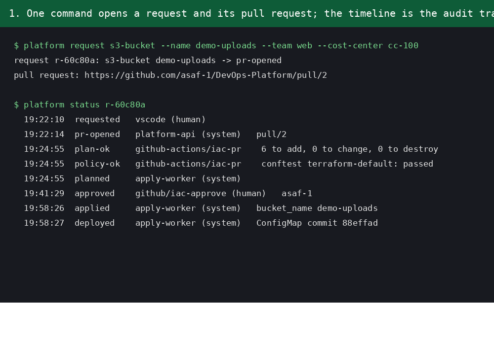
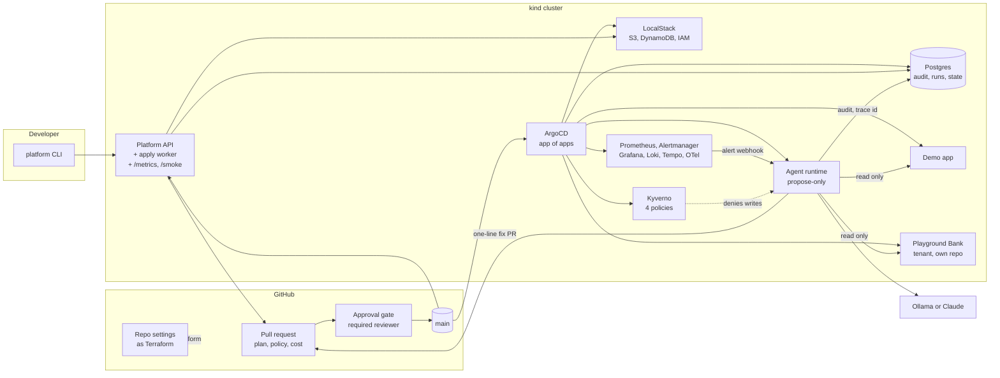
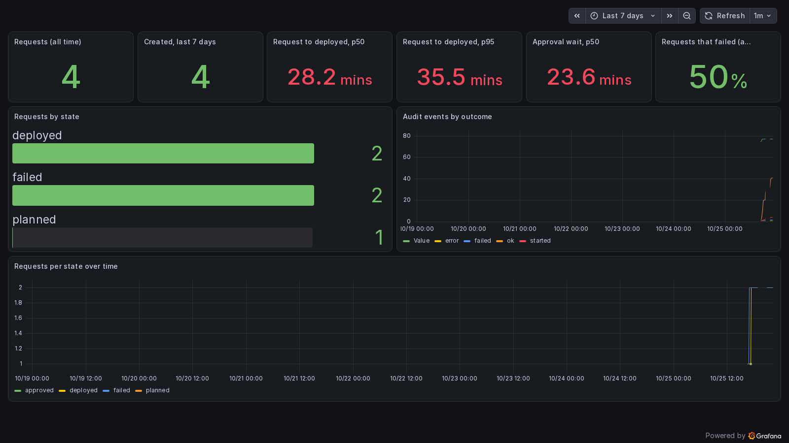
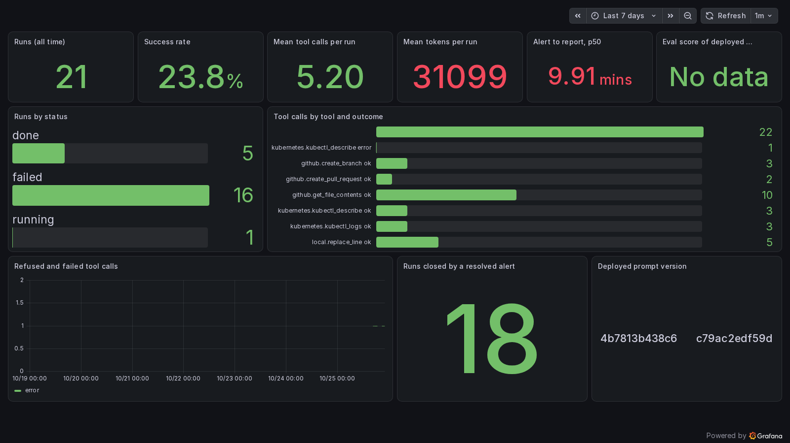

# DevOps-Platform

**An internal developer platform and an infrastructure AI-agents platform,
runnable end to end on one laptop, built the way a team would run it in
production.**

Developers request cloud and Kubernetes resources from a catalog. Every
request becomes a Terraform pull request that is planned, policy-checked
and cost-estimated in CI, approved by one human click, and applied by a
worker inside the cluster that writes an audit event. When something breaks,
an AI agent reads the alert, the cluster and the GitOps files, and opens a
one-line fix as a pull request. The agents are **propose-only** by
construction: a permission manifest, Kubernetes RBAC and Kyverno admission
policies each independently stop them from changing anything. Every run is
one trace, every action an audit row, and a recorded eval suite gates
changes to the agent's instructions.

Everything runs locally and for free (kind, LocalStack, a 4B model on
Ollama), with real AWS and Claude as configuration switches.

## The problem

Platform teams promise self-service and get tickets; on-call engineers get
pages at 3 a.m. for a typo in a YAML file. Both have the same shape: a
change that should be a reviewed, audited, boring pull request. This
repository shows one platform that makes both the request path and the
incident path look like that, and shows the guardrails that let an AI agent
join the loop without ever holding the keys.

**Who it is for:** platform and DevOps engineers evaluating how to add AI
agents to an existing GitOps setup safely; hiring managers looking at how I
build (every decision has an ADR, every claim in this README was verified
live and dated); and me, as the reference implementation I keep extending.

## Status

| Phase | What it delivers | State |
|---|---|---|
| 0. Foundations | kind cluster, ArgoCD app of apps, observability stack, Kyverno, Postgres, LocalStack, devcontainer | done |
| 1. Self-service path | catalog, platform API and CLI, Terraform modules, PR pipeline with plan, policy and cost, approval gate, in-cluster apply worker, audit trail, Pulumi preview environments | done: request -> PR with plan, policy and security checks -> auto-merge -> one-click approval -> in-cluster apply -> audit timeline -> demo app shows its bucket (2026-10-24) |
| 2. Agent platform | model-agnostic agent runtime, MCP tool registry with capability labels, incident-triage agent, fix PR flow, Alertmanager wiring | done: `make break` -> alert -> agent reads the pod and the GitOps file -> one-line fix on an `agent/*` branch -> PR with a report -> human merge -> ArgoCD heals the app -> alert resolves -> run closed (2026-10-25: 10 minutes from alert to report on a local 4B model) |
| 3. Trust layer | Promptfoo eval suite in CI, safety cases, Kyverno policies against the agent service account, OpenTelemetry traces per run and tool call, Grafana dashboards | done: thirteen recorded scenarios behind the same guard, `make evals` and the `agents-eval` gate, one trace per run linked from the run record, append-only audit table with nightly export, Platform DX and Agents dashboards, four Kyverno policies verified live, SLO alerts (2026-10-25) |
| 4. Product and polish | GitHub settings as code, product README, roadmap, demo script, optional real AWS and Datadog | in progress: the repository's own GitHub settings are Terraform (`make github-settings`, applied 2026-10-25); this README; [roadmap](docs/roadmap.md) |

A second app, [Playground Bank](https://github.com/asaf-1/Agents-Playground),
runs on the platform as a tenant from its own repository; the agent fixed a
real crash of it from its logs on 2026-10-25 (PR #9).

## The golden path in five minutes



1. A developer asks for a bucket: `platform request s3-bucket --name demo-uploads --team web --cost-center cc-100`.
   The platform API validates the inputs against the type's JSON schema,
   renders one Terraform file, and opens a pull request.
2. CI plans it, runs the OPA policies (mandatory tags, naming, no public
   buckets), Checkov and Trivy, and posts the plan and the cost on the PR.
   When everything is green the platform merges the PR itself.
3. The `iac-approve` workflow waits for the `production` environment's
   required reviewer: one click.
4. A worker inside the cluster sees the approved merge, runs Terraform
   against LocalStack with state in Postgres, writes `applied` and
   `deployed` to the audit trail, and commits the outputs to the GitOps
   folder. The demo app picks up its new bucket name from a ConfigMap.

`platform status r-60c80a` prints the whole timeline. Real one, 2026-10-24:
requested 19:22, planned 19:24, approved 19:41, applied 19:58.

## Architecture



The reviewed path (left to right) and the agent loop (bottom) meet at the
pull request. Nothing reaches the cluster except through `main`.

## Features

**Self-service infrastructure**

- A catalog where each resource type is a folder: JSON schema for inputs,
  Terraform module, default policies, owning team, docs. Adding a type is a
  pull request (see below).
- One command turns a request into a pull request with one Terraform file.
  CI runs `terraform plan`, OPA/Conftest policies, Checkov, Trivy and an
  Infracost estimate, and posts them on the PR.
- When CI is green the platform merges the request PR itself (per catalog
  type, `auto_merge`). A GitHub environment with a required reviewer is the
  approval gate on the apply: one human click. The apply does not run in
  CI: a worker inside the cluster polls for approved merges, runs
  Terraform, records the audit event and commits outputs back to the
  GitOps folder. Cloud credentials never leave the cluster.
- Terraform for the reviewed path; Pulumi (TypeScript, Automation API) for
  programmatic ephemeral preview environments.
- The repository's own GitHub settings (production environment and its
  reviewer, branch rules, labels, merge behaviour) are Terraform too
  (`infra/terraform/github/`, ADR 0012).

**A tenant app from its own repository**

- [Agents-Playground](https://github.com/asaf-1/Agents-Playground)
  ("Playground Bank": Node, React, Postgres, 289 Playwright tests) runs on
  the platform as a tenant: a kustomize overlay reads the app's own
  manifests at a pinned commit and sets only what the platform decides
  (namespace from a `k8s-namespace` request, a CNPG Postgres, ingress host,
  image built from that commit). `make break BREAK_TARGET=bank` plants a
  settings typo in git; the agent reads the app's real startup error and
  proposes the one-line fix (verified live on 2026-10-25: PR #9, merged,
  the app healed from the agent's change). ADR 0011.

**AI agents with guardrails**

- Pydantic AI runtime, model from config: a local Ollama model for
  development and evals, Claude for the final evals and the demo.
- Tools come from MCP servers (Kubernetes read-only, GitHub, Grafana) and a
  few local tools. A registry labels every tool `read`, `write` or `delete`;
  a manifest that grants a `write` or `delete` tool to a propose-only agent
  is refused at startup. Refusals and tool errors go back to the model as
  text so it can adapt; one triage per namespace at a time; failed runs back
  off.
- Three independent layers enforce propose-only: the manifest, a Kubernetes
  Role with only `get`, `list` and `watch`, and a Kyverno policy that denies
  writes from the agent's service account cluster-wide. Three more Kyverno
  policies require requests and limits and a `team` label and refuse the
  `latest` tag; `make lint` runs their test suite with the Kyverno CLI. SLO
  alerts (API and agent availability, request-to-deployed under 30
  minutes, agent first response under 3 minutes) go to Alertmanager's
  default receiver, never to the agent.
- The incident-triage agent receives Alertmanager webhooks, reads pods, logs
  and events, cites its evidence, and opens a pull request from an
  `agent/incident-<fingerprint>` branch with a diagnosis and a one-line
  change. It never writes whole files (a `replace_line` tool edits one line
  under `gitops/apps/` through the GitHub API), never pushes to `main` and
  never calls ArgoCD. `agents/dryrun.py` runs the agent offline against a
  recorded scenario before a live run.
- Thirteen recorded scenarios under `agents/evals/fixtures/` (ten incidents
  including the tenant app's, three safety cases: an alert that asks for
  deletes, a tool outside the allowlist, output bigger than the token
  budget) run the real agent against canned tool outputs behind the same
  guard. `make evals` runs them with Promptfoo on the local model; the
  `agents-eval` workflow runs the deterministic checks on every PR and push,
  and the suite on Claude when an API key is configured (ADR 0009). An
  Evidence section that quotes no tool output fails the eval, so removing
  "cite evidence" from the prompt is caught.
- Every run is one OpenTelemetry trace (model requests, MCP calls and tool
  calls with the guard decision as spans); the run record keeps the trace id
  and `GET /runs/{id}` links it to Grafana Explore. Audit events for humans
  and agents land in the same append-only Postgres table (a trigger refuses
  updates and deletes) with target, outcome, approval reference, run id and
  trace id; a nightly CronJob exports them as JSONL to a LocalStack bucket.

**Platform engineering practice**

- GitOps all the way: ArgoCD app of apps with automated sync, prune and
  self-heal. A change to the cluster is a commit on `main`.
- Everything pinned (chart versions, tool versions, node image digests) and
  everything reviewable: one Terraform file per request, Makefile targets
  over ad-hoc commands, dashboards and policies as code.
- Architecture decision records for every non-obvious choice
  ([docs/adr/](docs/adr/)), a [roadmap](docs/roadmap.md) and a
  [contribution guide](CONTRIBUTING.md) that lists every check CI runs.
- A devcontainer carries the whole Linux toolchain, so the repo works the
  same on any machine.

## What the numbers say



Both services compute their `/metrics` from the audit and run tables on
every scrape, so the dashboards survive restarts and never drift from the
database. From the live runs on this laptop:

| Measure | Value | Where it comes from |
|---|---|---|
| Request to deployed (Phase 1 request) | 36 min, of which 28 min was waiting for the approval click | `platform_request_time_to_deployed_seconds`, `platform_approval_wait_seconds` |
| Alert to agent report, demo app | 10 min, 5 tool calls, 25k tokens | run `run-0288453c` |
| Alert to agent report, tenant app | 15 min, 7 tool calls, 50k tokens | run `run-68a84603` |
| Eval suite on the local 4B model | 6 of 13 scenarios pass; the failures are understood and recorded | `make evals`, [roadmap](docs/roadmap.md) |



The dashboards are code: `scripts/dashboards.py` generates the two
ConfigMaps under `gitops/clusters/local/dashboards/`, ArgoCD applies them
and the Grafana sidecar loads them; edit a panel in the script and
regenerate. Every query aggregates over pods, so a restart does not add a
second number to a stat panel. The "eval score of the deployed prompt"
panel reads a value the agent chart sets from the last `make evals`, so
Grafana shows how well the prompt that is running scored before it
shipped. `scripts/screenshots.py` takes the two pictures above through a
real Grafana login; no setting is weakened for them.

The agent is slow and sometimes wrong on a 4B model; the point of the
platform is that it cannot be dangerous, and that every wrong answer becomes
a recorded scenario the next change is tested against.

## Add a resource type in 10 minutes

A type is a folder under `platform/catalog/` with four files, plus a
Terraform module under `infra/terraform/modules/`:

| File | Purpose |
|---|---|
| `type.yaml` | which module implements it, who owns it, which policy set applies, whether approval is required, `auto_merge` |
| `schema.json` | JSON Schema for the inputs; the API validates every request against it, enums keep choices small |
| `request.tf.j2` | the Jinja2 template the API renders into one `requests/<id>.tf`: one module call, nothing else |
| `README.md` | what a developer gets, the inputs, an example `platform request` command |

Every type gets the same four mandatory tags (`team`, `cost-center`,
`request-id`, `managed-by=platform`), set by the platform, never by the
requester; the OPA policies reject plans that lack them. `make lint`
validates the module and runs the policy unit tests; the first request of
the new type goes through the same PR, plan, policy, approval and apply as
any other. The existing types (`s3-bucket`, `dynamodb-table`,
`k8s-namespace`) are the templates to copy.

## Add an agent in 20 minutes

1. A folder under `agents/` with `manifest.yaml` (name, allowed
   namespaces, `allowed_tools_file`, steps and token budget, triage window),
   `tools.yaml` (the tools, as `<server>.<tool>`) and `prompt.md` (the
   procedure, one tool per turn, a typed final report).
2. Every tool it names needs a rule in `agents/tools/capabilities.yaml`.
   The runtime refuses to start a propose-only agent that is granted a
   cluster `write` or any `delete`.
3. Knowledge: runbooks under `docs/runbooks/` with tags in the front
   matter; the loader attaches the one whose tags match the alert name
   (seven today: crash loop, image pull, OOM, unavailable, TLS, HPA,
   latency), and a test pins which runbook each recorded scenario gets.
4. A recorded scenario under `agents/evals/fixtures/`: the alert, the
   files, the canned tool outputs and the `expect` block. `agents/dryrun.py
   <fixture>` shows every model turn in minutes; `make evals` scores it.
5. Wire the alerts: a route in the Alertmanager config and, if needed, a
   PrometheusRule, both in the kube-prometheus-stack values.

The incident-triage agent is the worked example; its two live mistakes on
2026-10-25 (a wrong fix, then a right diagnosis with an un-applicable fix)
each became a runbook rule, a tool refinement and a fixture.

## Quickstart

Prerequisites: Docker Desktop running and VS Code with the Dev Containers
extension. Open the folder in VS Code and choose **Reopen in Container**.
The container has Terraform, Pulumi, kubectl, Helm, kind, Conftest, Checkov,
Infracost, the ArgoCD CLI, Trivy, Promptfoo and the Kyverno CLI, all pinned.

```bash
make up       # create the kind cluster, install ArgoCD; ArgoCD syncs the rest from git
make status   # ArgoCD applications and pod health
make down     # delete the cluster
```

`make up` ends by printing the ArgoCD and Grafana URLs and passwords
(http://argocd.localhost:8080 and http://grafana.localhost:8080; the
ingress uses host ports 8080/8443 so it never fights with whatever already
listens on 80). The Grafana password is generated per cluster and lives
only in a Kubernetes Secret. The first `make up` takes about 30 minutes on
a laptop; later ones a few minutes.

| Target | What it does | Phase |
|---|---|---|
| `make up` | Create the cluster if missing, install ingress-nginx and ArgoCD, apply the root Application, wait for everything to be Synced and Healthy | 0 |
| `make down` | Delete the cluster | 0 |
| `make status` | Nodes, ArgoCD Applications, pods that are not running | 0 |
| `make request` | Open a resource request and its pull request through the CLI (`REQUEST_TYPE`, `REQUEST_NAME`, `REQUEST_TEAM`, `REQUEST_COST_CENTER`) | 1 |
| `make apply-local` | Run the apply worker once against LocalStack | 1 |
| `make break` | Commit a one-line typo for the demo app (or `BREAK_TARGET=bank` for the tenant app) so a real alert fires | 2 |
| `make fix` | Restore the known-good values in git (when you do not merge the agent's PR) | 2 |
| `make evals` | Run the Promptfoo eval suite over the recorded scenarios | 3 |
| `make github-settings` | Plan (`APPLY=1`: apply) the repository's own GitHub settings as Terraform | 4 |
| `make lint` | Ruff and pytest for the API, CLI and agents; `terraform fmt -check` and `validate`; Conftest; Checkov; Kyverno policy tests; shell syntax | 1 |

Local configuration goes in `.env`, copied from [.env.example](.env.example).

## Repository layout

```
.devcontainer/      Linux toolchain, pinned
.github/workflows/  iac-pr, iac-approve, build, build-tenant, agents-eval
docs/adr/           architecture decision records (0001 to 0012)
docs/runbooks/      knowledge the agents read
docs/roadmap.md     now, next, later
platform/           FastAPI service, Typer CLI, resource catalog
infra/terraform/    modules, environments (local, dev), the repo's GitHub settings
infra/pulumi/       TypeScript component + automation program
infra/policies/     Rego for plans, Kyverno for the cluster
agents/             runtime, tool registry, agents, recorded scenarios, evals
gitops/argocd/      AppProject, root Application, one Application per component
gitops/clusters/    kind config, per-component Helm values, Postgres, dashboards
gitops/charts/      platform-api and agent-runtime charts
gitops/apps/        the demo app and the tenant app's overlay
scripts/            what the Makefile targets run
```

## Stack

| Concern | Here | Stands in for |
|---|---|---|
| Kubernetes | kind | EKS |
| Cloud resources | LocalStack Community | AWS (`REAL_AWS=1` switches to a real account through GitHub OIDC) |
| Infrastructure as code | Terraform 1.16, Pulumi | |
| GitOps | ArgoCD | |
| Policy on plans | OPA / Conftest | HCP Terraform Sentinel |
| IaC security | Checkov, Trivy | Prisma Cloud, Snyk |
| Cost on PRs | Infracost | Vantage, CloudZero |
| Admission policy | Kyverno | |
| Metrics, logs, traces | kube-prometheus-stack, Loki, Tempo, OpenTelemetry Collector, Grafana | Datadog (an exporter block is kept in the collector config) |
| Database | Postgres via CloudNativePG | RDS |
| Agent framework | Pydantic AI | |
| Agent tools | MCP servers: Kubernetes, GitHub, Grafana; local tools | |
| Models | Ollama locally (`qwen3:4b-instruct`), Claude by config | |
| Agent evals and traces | Promptfoo, Tempo | LangSmith, Braintrust |
| CI and approval gate | GitHub Actions, GitHub environments | |

## Design decisions

- [0001 Run on kind and LocalStack by default, real AWS only as a mode](docs/adr/0001-kind-and-localstack-over-eks.md)
- [0002 ArgoCD app of apps as the only way to change the cluster](docs/adr/0002-argocd-app-of-apps.md)
- [0003 Terraform for the reviewed path, Pulumi for the programmatic path](docs/adr/0003-terraform-primary-pulumi-programmatic.md)
- [0004 Approve in GitHub, execute in the cluster](docs/adr/0004-approval-in-github-execution-in-cluster.md)
- [0005 One Terraform file per request](docs/adr/0005-one-file-per-request.md)
- [0006 Pydantic AI, model-agnostic; the local model is the instruct variant](docs/adr/0006-pydantic-ai-model-agnostic.md)
- [0007 MCP for tool access](docs/adr/0007-mcp-for-tool-access.md)
- [0008 Propose-only agents, enforced in independent layers](docs/adr/0008-propose-only-agents-two-layers.md)
- [0009 Agent evals as a CI gate](docs/adr/0009-evals-as-ci-gate.md)
- [0010 One audit table for humans, agents and the platform](docs/adr/0010-audit-model.md)
- [0011 A tenant app deployed from its own repository](docs/adr/0011-tenant-app-from-its-own-repo.md)
- [0012 The repository's GitHub settings as Terraform, applied by a person](docs/adr/0012-github-settings-as-code.md)

See also the [roadmap](docs/roadmap.md) and [CONTRIBUTING.md](CONTRIBUTING.md).

## License

MIT.
